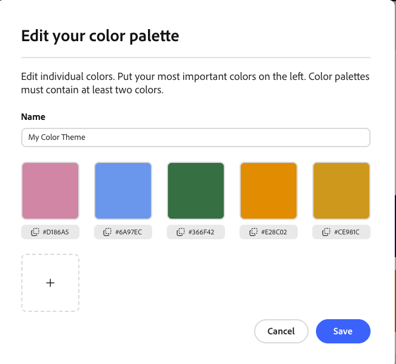

# Shubham Kumar
**Course:** CS 4241  
**Assignment:** Assignment 1  
**Deployed Site:** https://a1-shubhamkumar.onrender.com/

**Note for Grader: I am submitting this assignment after the original deadline because I enrolled in the course late. I have already communicated this situation with Professor Roberts, and an extension for this assignment was approved. **

This project is a personal profile webpage created for CS 4241 - Assignment 1. It displays my class year, major and minor, previous WPI Computer Science courses, and my experience with HTML, CSS, and JavaScript / TypeScript.

## Technical Achievements
- **Styled page with CSS**: Added CSS rules to improve the layout and readability of the page.
  - `body`: Added page margins and set the primary font.
  - `h1`: Increased the font size and applied the green palette color.
  - `h2`: Added spacing above the heading and applied the orange palette color.
  - `p`: Increased line spacing for improved readability.
  - `li`: Added spacing, padding, and a gold left border to list items.

- **JavaScript animation**: Added a simple fade-in animation to the main heading. JavaScript gradually increases the heading's opacity using `requestAnimationFrame()` when the page loads.

- **Semantic HTML**: Added `header`, `main`, `section`, `footer`, and `a` elements to give the page more meaningful structure. The header contains the main page heading, the main element contains the primary content, sections group related information, the footer contains course information, and the link directs users to the WPI website.

## Design Achievements
- **Adobe Color Palette**: Generated a five-color palette using Adobe Color and used all five colors throughout the webpage. I used green (`#366F42`) for the main heading, orange (`#E28C02`) for the secondary heading, gold (`#CE981C`) for the list accents, blue (`#6A97EC`) for the header border, and pink (`#D186A5`) for the footer background. A screenshot of the generated palette is included in the repository as `color-palette.png`.

- **Used the Roboto Font from Google Fonts**: Imported the Roboto font from Google Fonts and used it as the primary font throughout the webpage.
