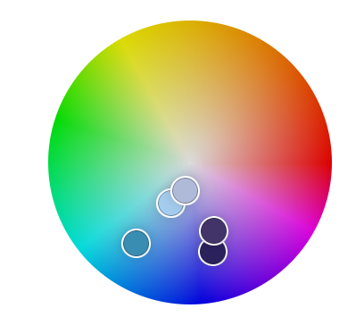

# David Peterson

## https://a1-davidpeterson.onrender.com/

This project is a minimal webpage that uses: semantic HTML structures, CSS styling, DOM manipulation with JavaScript, and deployment using Render.

## Technical Achievements

**CSS Styles**

1. `body`: Uses `light-dark()` so text and background colors use the current theme.
2. `code`: Uses `light-dark()` colors, bold text, small padding, and rounded corners.
3. `button`: Styled as a pill-shaped button with a glowing drop-shadow, custom padding, and the Rubik Spray Paint font.
4. `h1`: Styled with the Rubik Spray Paint font and a blue accent color.
5. `table`: Styled with a background color, border, glowing drop-shadow, and custom text color.

**JavaScript Animation:** I added a little animation on an image of a fern so it now spins forever and ever and will never stop.

**Semantic HTML Tags** I experimented with semantic HTML to ensure accessible and well-structured code.

1. `<header>`: Used to contain my name.
2. ``: Used to add a fun image of a glorious fern.
3. `<button>`: Used to make a dark mode toggle.
4. `<footer>`: Used to add a little link to my website to the site at the bottom.
5. `<table>` & `<tr>` & `<td>`: Used to create a table showing off the classes I am taking.

## Design Achievements

**Color Palette:** I generated a custom color palette using Adobe Color, then hand-picked a working set of colors for the page: `#423469` `#efedea` `#AFBAD9` `#398DB3` `#A4CCEE`.
The screen shot of the original color wheel is in the project root as colorWheel.png.

### Color Wheel

**Google Fonts:** I integrated the **Rubik Spray Paint** font from Google Fonts.
I used it for some titles and headers to give them more of a POP.
