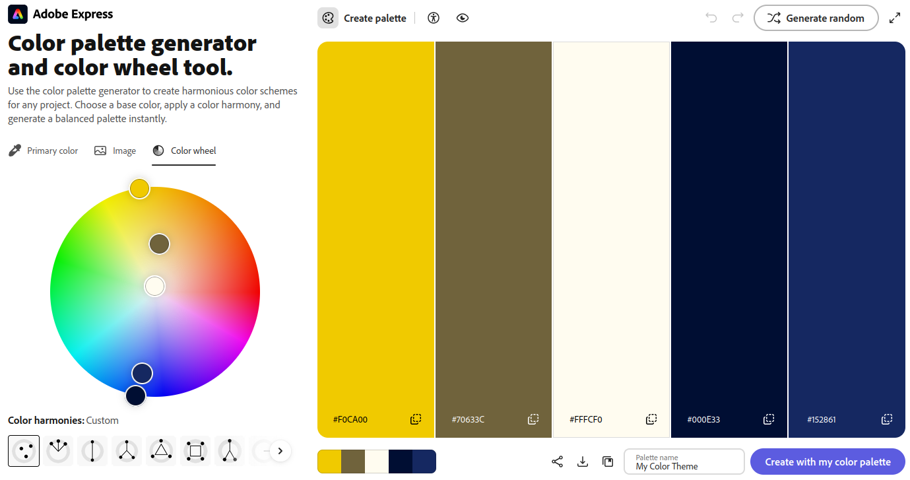

Assignment 1 - Hello World: Basic Deployment w/ Git, GitHub, Render
===

### Lex Johnson

[https://a1-lexjohnson.onrender.com](https://a1-lexjohnson.onrender.com)

For this project, I designed a website with fairly basic content and
focused on using CSS to making the style interesting. I'm
particularly happy with how the header looks; I used a dot matrix
font and a drop shadow effect to make it resemble one of those lit-up
scrolling signs. (As tempting as it was, I did refrain from using the
\<marquee\> tag.)

## Technical Achievements
- **Styled page with CSS**: Added rules for body, header, main, h1, and h2, and used variables defined in :root to make a color palette
- **Semantic HTML tags**: Used the header and main tags to lay out the page

## Design Achievements
- **Font from Google Fonts**: Used the Bitcount font as a display font for the page title and headers
- **Color palette**: Made a color palette using the Adobe tool (see the screenshot below) and defined the colors using CSS variables

