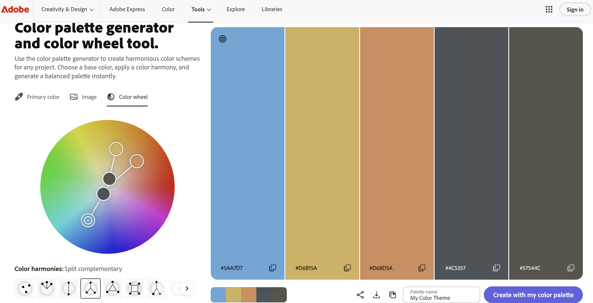

Dexter Haehnichen
http://www.onocu.com:3000 (self-hosted; be sure to include the port number)

This project is a website showing my very basic skills in HTML and CSS. It has some information about myself, my hobbies, and my education. 

## Technical Achievements
- **Styled page with CSS**: Added rules for the p, h1, h2, h3, a, section, header, and footer selectors, as well as many others.

- **Used semantic HTML tags**: Used tags with semantic meaning including header, footer, links, tables, and sections.

## Design Achievements
- **Usd an Adobe color palette** I used all the colors from the following color wheel in at least one place in my website. I honestly don't think five colors on a half-page website looks very good, but I'm no graphic designer. 

- **Used the Montserrat Font from Google Fonts**: I used Montserrat as the font for the primary copy text in my site.
