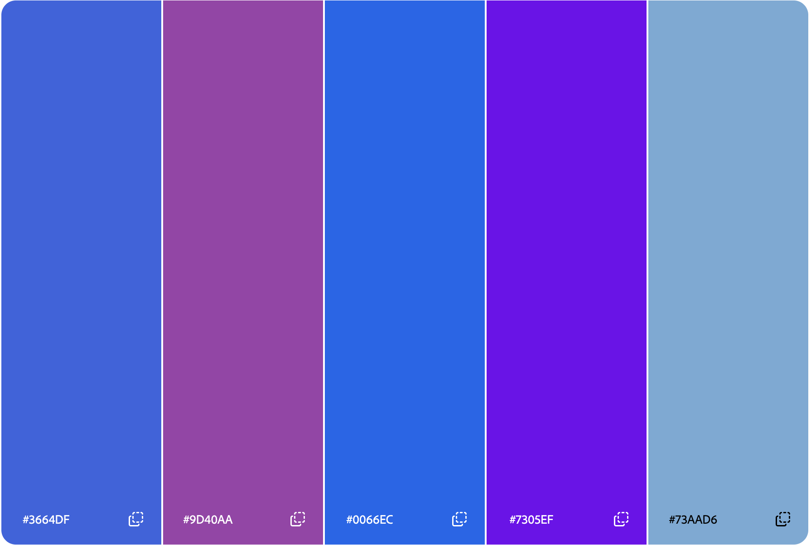

Aidan Fisher
https://a1-gettingstarted-nh9n.onrender.com/

This project is a basic personal info page built as part of learning Git, GitHub, and Render deployment. It displays my background, experience, and some fun facts, styled with custom CSS and a small JavaScript interaction.

## Technical Achievements
- **Styled page with CSS**: Created a separate `style.css` file linked in `index.html`. Added rules for `body` (font-family, background-color, text color, margin, line-height), `h1`, `h2`, and `a`/`a:hover` (link color and underline behavior on hover).
- **JavaScript animation**: Added `script.js`, which uses `document.querySelectorAll('h1, h2')` to select all heading elements on the page and attaches `mouseover`/`mouseout` event listeners so each heading changes color when hovered over and reverts when the mouse leaves.
- **Semantic HTML tags**: Restructured the page using `<header>` (name, major/minor, intro), two `<section>` elements (Fun Facts and Experience), a `<footer>` with a link to my GitHub profile, and a proper `<ul>`/`<li>` list structure for the fun facts (previously unwrapped list items).

## Design Achievements
- **Color palette**: Built a 5-color palette using color.adobe.com and applied the colors across `style.css` (background, headings, and link colors). Screenshot of the palette below.

- **Google Font**: Used the Archivo Black font from Google Fonts, applied to the `body` element in `style.css`.