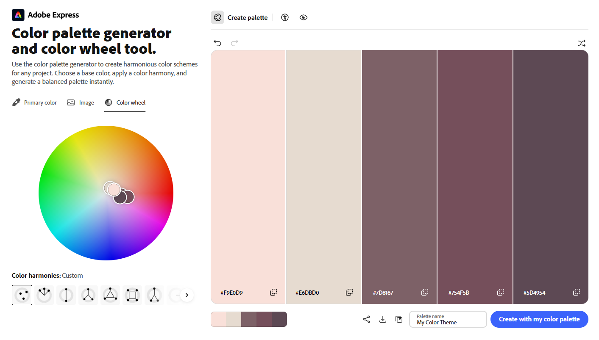

Assignment 1 - Hello World: Basic Deployment w/ Git, GitHub, Render
===

*DUE: Friday, August28, 2025 by 1:59 PM*

Vu Nguyen https://a1-vunguyen.onrender.com

Technical Achievements
---
### (5 points) Style your page using CSS. Each style rule you apply will get you 1 point for a maximum of 5 points
- **body**: Sets the page background color, uses Arial as the primary font, limits the page width to 800px.
- **h1**: Sets the main heading color to dark purple, adjusts font size.
- **h2**: Sets the section heading color and adds a bottom border.
- **a:hover**: Changes the color of links when the mouse hovers over them.
- **b**: Changes the color of bold text.
- **table**: Sets the table width and collapses the borders into a single grid.
- **th, td**: Adds borders, spacing, centered text to the table cells.
- **th**: Sets the background, text colors of the table headers.

### (5 points) Add a simple JavaScript animation to the page.
- N/A

### (5 points) Experiment with other semantic HTML tags (links, images, tables, header, footer, etc.). Each extra tag you use will get you 1 point for a maximum of 5 points. Be sure to describe the tags you use in your README.
- Uses tables tag for the previous CS courses listing.

Design Achievements
---
### (10 points) Create a color palette using color.adobe.com. Use all the colors in the palette in your webpage by implementing the appropriate CSS. Add a small screenshot of the color wheel for your color palette to your repo.

### (5 points) Use a font from Google Fonts in your website.
- The website uses font [Inter](https://fonts.google.com/specimen/Inter).